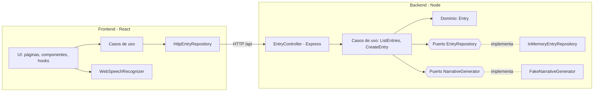

# Diario IA

Diario personal en el que **dictas** (o escribes) lo que te ha pasado en el día, tal cual te sale, y una **IA lo transforma en un relato coherente**. Cada entrada guarda el texto original en bruto y el relato generado.

> Estado: base de proyecto. La IA está simulada con un adaptador falso (`FakeNarrativeGenerator`) y los datos se guardan en memoria. Ambas piezas están detrás de puertos, así que se pueden cambiar por implementaciones reales sin tocar el dominio.

---

## Índice

- [Funcionalidades](#funcionalidades)
- [Stack](#stack)
- [Puesta en marcha](#puesta-en-marcha)
- [Scripts](#scripts)
- [Arquitectura](#arquitectura)
- [Estructura de carpetas](#estructura-de-carpetas)
- [API](#api)
- [Añadir un proveedor de IA real](#añadir-un-proveedor-de-ia-real)
- [Principios de clean code aplicados](#principios-de-clean-code-aplicados)
- [Limitaciones conocidas](#limitaciones-conocidas)
- [Próximos pasos](#próximos-pasos)

---

## Funcionalidades

- Listado de entradas del diario ordenadas de la más reciente a la más antigua.
- Creación de entradas por fecha (se permiten varias entradas el mismo día).
- Dictado por voz desde el navegador (Web Speech API, idioma `es-ES`).
- Transformación del texto en bruto en relato a través del puerto `NarrativeGenerator`.
- Consulta del texto original de cada entrada.

## Stack

| Capa     | Tecnología                                         |
| -------- | -------------------------------------------------- |
| Backend  | Node.js 20, Express 5, JavaScript (ES Modules)     |
| Frontend | React 18, Vite 5                                   |
| Tests    | Vitest, Supertest, Testing Library                 |
| Calidad  | ESLint 9 (flat config), Prettier, EditorConfig     |
| Monorepo | npm workspaces (`apps/backend`, `apps/frontend`)   |

## Puesta en marcha

**Requisitos:** Node.js 20 o superior (hay un `.nvmrc`: `nvm use`).

```bash
npm install
cp .env.example .env   # opcional: los valores por defecto ya funcionan
npm run dev
```

- Frontend: <http://localhost:5173>
- API: <http://localhost:3000/api/entries>

Vite redirige `/api` al backend, así que el frontend no necesita configurar URLs.

### Variables de entorno

| Variable             | Por defecto | Descripción                                   |
| -------------------- | ----------- | --------------------------------------------- |
| `PORT`               | `3000`      | Puerto del backend                            |
| `NARRATIVE_PROVIDER` | `fake`      | Adaptador de IA a usar para generar el relato |

## Scripts

Desde la raíz:

| Script           | Qué hace                                         |
| ---------------- | ------------------------------------------------ |
| `npm run dev`    | Arranca backend (con `--watch`) y frontend a la vez |
| `npm start`      | Arranca solo el backend                          |
| `npm run build`  | Compila el frontend para producción              |
| `npm test`       | Ejecuta los tests de todos los workspaces        |
| `npm run lint`   | Analiza el código con ESLint                     |
| `npm run format` | Formatea el código con Prettier                  |

Para trabajar sobre un único workspace: `npm run test -w apps/backend`.

## Arquitectura

El proyecto sigue **arquitectura hexagonal (puertos y adaptadores)**. La regla principal es que **las dependencias siempre apuntan hacia dentro**: la infraestructura conoce a la aplicación y la aplicación al dominio, nunca al revés.



### Backend

| Capa               | Responsabilidad                                                    | Ejemplos                                         |
| ------------------ | ------------------------------------------------------------------ | ------------------------------------------------ |
| **Dominio**        | Reglas de negocio puras, sin dependencias externas                 | `Entry`, `ValidationError`                       |
| **Aplicación**     | Casos de uso que orquestan el dominio y definen los puertos        | `ListEntries`, `CreateEntry`, `NarrativeGenerator` |
| **Infraestructura**| Adaptadores concretos: HTTP, persistencia, IA                      | `EntryController`, `InMemoryEntryRepository`     |
| **Config**         | *Composition root*: el único sitio donde se conectan las piezas    | `container.js`, `env.js`                         |

### Frontend

Se aplica la misma idea en versión ligera:

- `domain/`: utilidades puras (formato de fechas).
- `application/`: casos de uso que reciben el repositorio inyectado.
- `infrastructure/`: adaptadores de la API HTTP y del reconocimiento de voz.
- `ui/`: React. Los componentes obtienen sus dependencias a través de `DependenciesContext`, lo que permite testearlos con dobles sin mockear módulos.
- `config/dependencies.js`: *composition root* del frontend.

## Estructura de carpetas

```text
diario-ia/
├── apps/
│   ├── backend/
│   │   ├── src/
│   │   │   ├── domain/            # Entidades y errores de dominio
│   │   │   ├── application/
│   │   │   │   ├── ports/         # Contratos: EntryRepository, NarrativeGenerator
│   │   │   │   └── use-cases/     # ListEntries, CreateEntry
│   │   │   ├── infrastructure/
│   │   │   │   ├── ai/            # Adaptadores de IA
│   │   │   │   ├── persistence/   # Adaptadores de almacenamiento + datos semilla
│   │   │   │   └── http/          # Express: app, rutas, controladores, middlewares
│   │   │   ├── config/            # Variables de entorno y composition root
│   │   │   └── main.js            # Punto de entrada
│   │   └── tests/                 # unit/ e integration/
│   └── frontend/
│       └── src/
│           ├── domain/
│           ├── application/
│           ├── infrastructure/    # api/ y speech/
│           ├── ui/                # pages/, components/, hooks/
│           ├── config/
│           └── main.jsx
├── .env.example
├── eslint.config.js
└── package.json                   # Workspaces y scripts globales
```

## API

| Método | Ruta           | Cuerpo                                     | Respuesta                    |
| ------ | -------------- | ------------------------------------------ | ---------------------------- |
| GET    | `/api/health`  | —                                          | `200 { "status": "ok" }`     |
| GET    | `/api/entries` | —                                          | `200 [Entry]`                |
| POST   | `/api/entries` | `{ "date": "YYYY-MM-DD", "rawText": "…" }` | `201 Entry` · `400 { error }` |

Ejemplo:

```bash
curl -X POST http://localhost:3000/api/entries \
  -H "Content-Type: application/json" \
  -d '{"date":"2026-10-23","rawText":"pues hoy fui al cine con ana. la peli genial"}'
```

```json
{
  "id": "6f1c…",
  "date": "2026-10-23",
  "rawText": "pues hoy fui al cine con ana. la peli genial",
  "narrative": "El 23 de octubre de 2026: Hoy fui al cine con ana. La peli genial.",
  "createdAt": "2026-10-23T19:42:10.000Z"
}
```

## Añadir un proveedor de IA real

1. Crea un adaptador en `apps/backend/src/infrastructure/ai/` que extienda el puerto:

   ```js
   import { NarrativeGenerator } from '../../application/ports/NarrativeGenerator.js';

   export class OpenAiNarrativeGenerator extends NarrativeGenerator {
     async generate({ rawText, date }) {
       // Llamar al proveedor y devolver el relato como string
     }
   }
   ```

2. Regístralo en `apps/backend/src/config/container.js`:

   ```js
   const narrativeGeneratorFactories = {
     fake: () => new FakeNarrativeGenerator(),
     openai: () => new OpenAiNarrativeGenerator({ apiKey: process.env.OPENAI_API_KEY }),
   };
   ```

3. Usa `NARRATIVE_PROVIDER=openai` en `.env` y añade la API key (nunca la subas al repositorio).

El dominio, los casos de uso y el frontend no cambian. Lo mismo vale para la persistencia: implementa `EntryRepository` (fichero, SQLite, MongoDB…) y conéctalo en el contenedor.

## Principios de clean code aplicados

- **Inversión de dependencias:** los casos de uso dependen de puertos, no de implementaciones.
- **Inyección por constructor:** sin singletons ni `import` de infraestructura dentro del dominio o la aplicación. Por eso los tests no necesitan mocks de módulos.
- **Responsabilidad única:** cada caso de uso hace una cosa; los controladores solo traducen HTTP ↔ aplicación.
- **Dominio que se valida a sí mismo:** `Entry` no puede existir en un estado inválido y es inmutable.
- **Nombres expresivos** y funciones pequeñas.
- **Errores de dominio tipados** (`ValidationError`) que la capa HTTP traduce a códigos de estado.
- **Tests en varios niveles:** unitarios de dominio y casos de uso, integración HTTP con Supertest y tests de UI con Testing Library.

## Limitaciones conocidas

- **Persistencia en memoria:** las entradas se pierden al reiniciar el backend (se cargan 3 entradas de ejemplo al arrancar).
- **IA simulada:** `FakeNarrativeGenerator` solo quita muletillas y da formato; no reescribe el texto.
- **Dictado:** la Web Speech API solo funciona en navegadores basados en Chromium (Chrome, Edge). En los demás se muestra un aviso y se puede escribir a mano.
- Sin autenticación ni multiusuario.

## Próximos pasos

- [ ] Adaptador de IA real (OpenAI, Gemini u Ollama local).
- [ ] Persistencia duradera (fichero JSON o SQLite).
- [ ] Editar y borrar entradas.
- [ ] Vista por calendario y filtro por fechas.
- [ ] Usuarios y autenticación.
